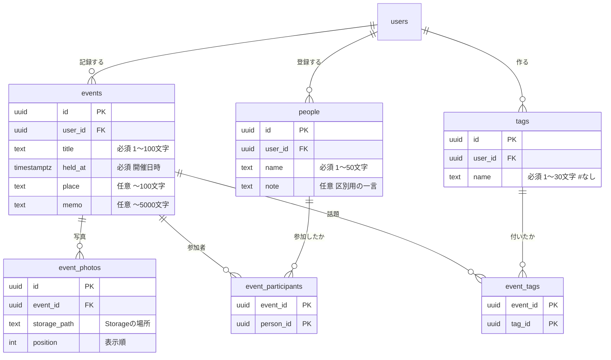

# データベース設計

nomiメモのデータは Supabase（PostgreSQL）に保存しています。
SQL の本体は [`supabase/migrations/`](../supabase/migrations/) にあります。

> フロント担当の人へ：DB を直接触ることはありません。`lib/data/` の関数（#3 で用意）を使ってください。
> このページは「どんなデータがあるのか」を知るための資料です。

---
## データベース全体像

すべてのテーブルに `user_id`（だれのデータか）、`created_at`（作成日時）がある
`events` と `people` には `updated_at`（更新日時、自動更新）がある

---

## テーブル一覧

| テーブル | 中身 | 決まりごと |
|---|---|---|
| `events` | 飲み会 | タイムラインは `held_at` の新しい順 |
| `event_photos` | 飲み会の写真 | 画像そのものは Storage に置き、ここには場所（パス）だけ持つ。`position` の小さい順に表示 |
| `people` | 人 | 同姓同名でも別人として登録できる。`note`（例：伊藤先生とSSの伊藤くん）で見分ける |
| `event_participants` | 飲み会 × 人 | 同じ人を同じ飲み会に二重登録できない |
| `tags` | 話題タグ | 同じユーザー内で同じ名前は1つ（`AWS` と `aws` も同じ扱い）。先頭の `#` は保存しない（表示時に付ける） |
| `event_tags` | 飲み会 × タグ | 同じタグを同じ飲み会に二重登録できない |

### 削除したときの動き

| 消したもの | 一緒に消えるもの | 残るもの |
|---|---|---|
| 飲み会 | その飲み会の写真の記録・参加者の紐づけ・タグの紐づけ | 人・タグ（他の飲み会で使っているかもしれないため） |
| 人 | その人の参加記録 | 飲み会 |
| タグ | そのタグの紐づけ | 飲み会 |

> ⚠️ 写真の**画像ファイル**（Storage 側）は DB の削除では消えません！イシュー#6 で削除処理を用意しますぞ

---

## セキュリティ（RLS）

自分が作ったデータしか見られない・変えられないようにしています

| 状況 | 結果 |
|---|---|
| 未ログイン | どのテーブルも読めない |
| ログイン中 | 自分の `user_id` の行だけ読み書きできる |
| 他人のデータを更新・削除しようとする | 0件扱い（何も起きない） |
| `user_id` を他人にして作成しようとする | エラー |
| 自分のタグを他人の飲み会に付けようとする | エラー（複合外部キーで防止） |

作成時の `user_id` は自動でログイン中のユーザーになるので、アプリ側で指定する必要はありません。
ただし、supabaseの設定変更で例えばgoogleなどOauth認証も検討中

### テスト済みの項目

migration 適用後に以下確認ずみ

1. 同姓同名の人を登録できる
2. 大文字小文字だけ違うタグは重複エラー
3. `#` 付きのタグはエラー
4. 他人のデータは見えない（全テーブル）
5. 他人のデータを更新・削除できない
6. `user_id` を偽装して作成できない
7. 別ユーザーなら同じ名前のタグを作れる
8. 他人の飲み会に自分のタグを紐づけられない
9. 未ログインではテーブルを読めない
10. 飲み会を削除すると紐づけが消え、人・タグは残る
11. `updated_at` が自動更新される

---

## スキーマを変更したいとき

1. 丹下に相談
2. 新しい migration ファイルを `supabase/migrations/` に追加
3. 型を再生成（#3 で手順を追記予定）
